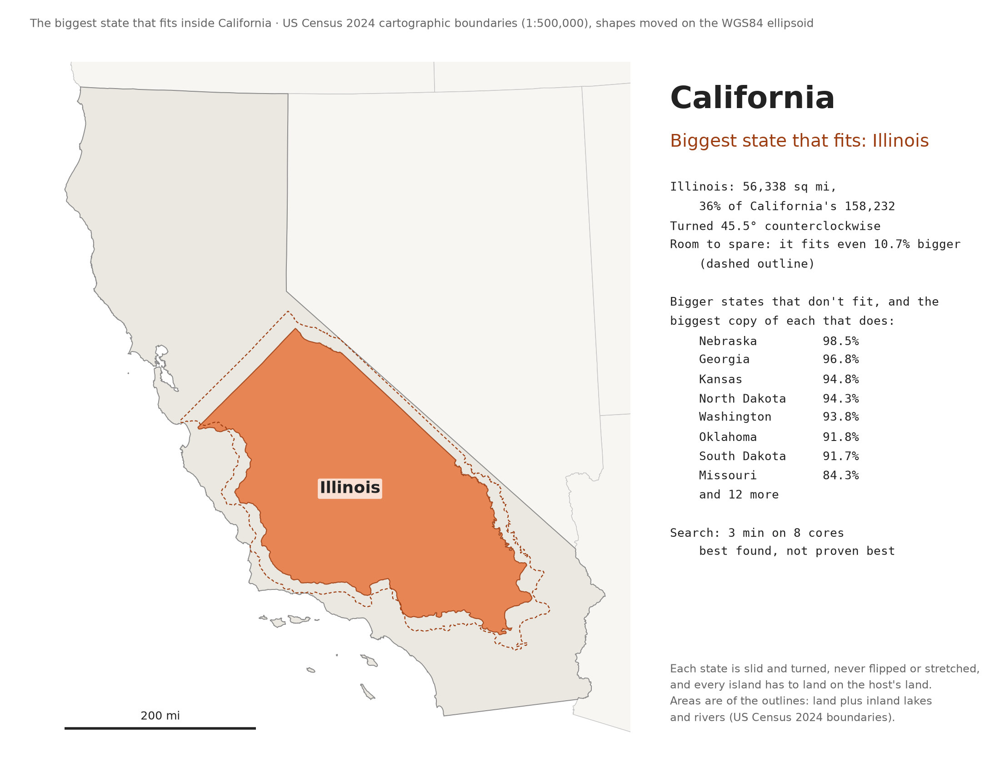

# Largest squares in US states

What is the largest square that fits inside each US state? It sounds like a
simple question, but on a curved Earth "square" can mean several different
things, and the answers differ by as much as 46 miles (in Alaska). This
project computes three versions for all 50 states and draws them as maps:


| Command | What it finds |
|---|---|
| `aligned` | The largest box bounded by two **parallels and two meridians** (lines of latitude and longitude), sized so its height equals its width at its middle latitude. Not truly square: its north edge is shorter than its south edge. |
| `north` | The largest **true square** whose sides face north, south, east and west. |
| `rotated` | The largest **true square at any rotation**. |
| `compare` | An **animated GIF** (and MP4 video) flipping between the `north` and `rotated` maps, showing which squares grow by turning and by how much. With `--close-up`, one zoomed-in flip-book per state instead. |
| `pack` | The biggest size at which **17 equal squares** (or any `--count`) fit in a state together, without overlapping: a state-shaped version of the famous [17 squares puzzle](#packing-17-squares). This one is a long random search, not a proof. |
| `nest` | The **biggest other state that fits inside** a state, slid and turned but never flipped or stretched (see [States inside states](#states-inside-states)). Also a search, not a proof. |

Each single-square search is a branch-and-bound that finds the *best possible*
square, not just a good one, to within a stated tolerance of a few feet to a few tens of
feet (subject to the caveats under [Guarantees](#guarantees-and-their-limits)).

Facing north versus free to rotate (darker squares gain more by turning):


## Quick start

You need [uv](https://docs.astral.sh/uv/). `main.py` lists its own dependencies
([PEP 723](https://peps.python.org/pep-0723/) inline script metadata), so uv
builds a matching environment in its cache automatically, with no install
step. (For running the tests, see [Development](#development).)

```sh
git clone https://github.com/michael-gebis/state-squares.git
cd state-squares
uv run main.py aligned              # all 50 states
uv run main.py north
uv run main.py rotated
uv run main.py compare              # north vs rotated, as a GIF
uv run main.py rotated WI CO TX     # just these states
uv run main.py compare NM --close-up # flip-book zoomed in on New Mexico
uv run main.py rotated --help       # all options
uv run main.py pack WI --minutes 10 # 17 squares packed into Wisconsin
uv run main.py nest CA              # the biggest state that fits in California
```

The first run downloads the Census boundary file (about 3 MB) into `data/`.
Options:

- `STATES...`: postal abbreviations to compute (default: all 50)
- `--out DIR`: where to write results (default `out/`)
- `--no-draw`: write only the CSV, skip the maps
- `--tol X`: how close to optimal the search must get (see [Accuracy](#accuracy))

Each command writes, with `PREFIX` being `aligned`, `north` or `rotated`:

| File | Contents |
|---|---|
| `PREFIX_squares.svg`, `.pdf` | Detailed US map with every state's square and its side length; Alaska and Hawaii as insets |
| `PREFIX_social.png` | A simplified 2400×1350 version of the map for social media (see [below](#social-media-images)) |
| `PREFIX_states.pdf` | A ranked table, then one zoomed page per state with the square, the boundary points that stop it growing, guide lines, a scale bar, and the numbers |
| `PREFIX_squares.csv` | All the numbers: side length, center, corners, rotation, edge widths |

`compare` instead writes `north_vs_rotated.gif` (see [below](#comparison-gif)),
the same flip-book as `north_vs_rotated.mp4` for sites that take video rather
than GIFs, such as Threads (only if [ffmpeg](https://ffmpeg.org/) is
installed), and `north_vs_rotated.csv`, which lists each state's north-facing
and rotated side lengths and the gain, biggest gain first. With `--close-up`,
it makes one zoomed-in flip-book per state instead,
`ABBR_north_vs_rotated.gif` and `.mp4` (see [below](#close-ups)), and leaves
the CSV and the US map alone.

On a typical desktop the searches take about 1½ minutes for `aligned`, 15
seconds for `north` and 4–5 minutes for `rotated` (so about 5 for `compare`),
plus about a minute to draw the outputs.

`pack` runs for as long as you let it (`--minutes`, default 5, per state) and
has options of its own: `--count` (default 17), `--workers` (processes
searching in parallel, default one per CPU), `--seed`, and `--verbose` (report
every finished run). It writes to `out/pack/`:

| File | Contents |
|---|---|
| `ABBR_17_squares.pdf`, `.png` | The state with its packed squares, where they touch each other and the border, and the numbers |
| `ABBR_17_squares.csv` | One row per square: side, rotation, center, corners, and the exact parameters to rebuild it |
| `ABBR_17_squares_checkpoint.csv` | The best layout so far, saved whenever the search improves (not yet checked on the ellipsoid) |
| `pack_17_summary.csv` | One row per state searched so far: side, area limit, how much of the state is covered, search effort |

`nest` tries the other states inside each chosen state, biggest first, and
stops once one fits (`--all` tries every smaller state anyway). It takes about
3 minutes for California on 8 cores, about an hour for all 50, and has
`--workers` too. After searching,
it redraws the US map from every state searched so far; `--redraw` searches
nothing and redraws the pages and the map from the saved results. It writes
to `out/nest/`:

| File | Contents |
|---|---|
| `nest_map.svg`, `.pdf` | US map with the biggest state that fits drawn inside each state |
| `nest_social.png` | A 2400×1350 version of the map for social media |
| `ABBR_nest.pdf`, `.png` | The state with the biggest state that fits drawn inside it, the biggest copy of it that fits (dashed), and how close the bigger states came |
| `ABBR_nest.csv` | One row per state tried: area, best scale, whether it fits, and the placement (center and turn) |
| `nest_summary.csv` | One row per state searched so far: the biggest state that fits, how much room it has, and the closest miss |

On Windows, `pack` and `nest` also ask the computer not to go to sleep until
they finish, so they can run overnight.

## Results

Side lengths in miles for a selection of states (the CSVs have all 50).
Rotation is counterclockwise from north.

| State | `aligned` (north / south edge) | `north` | `rotated` (tilt) |
|---|---|---|---|
| Alaska | 552.2 (466.7 / 635.0) | 505.8 | 521.8 (8.2°) |
| New Mexico | 341.4 (331.0 / 351.1) | 333.4 | 333.9 (−1.7°) |
| Texas | 322.0 (313.8 / 329.7) | 324.8 | **341.8** (43.6°) |
| Montana | 275.8 (265.4 / 285.9) | 274.2 | 275.3 (0.9°) |
| Colorado | 275.7 (267.8 / 283.3) | 273.9 | 274.1 (−0.1°) |
| California | 196.3 (192.1 / 200.4) | 196.0 | 210.4 (−42.0°) |
| Wisconsin | 156.3 (153.2 / 159.3) | 157.7 | 167.5 (15.4°) |
| Florida | 109.0 (108.2 / 109.8) | 108.7 | 113.6 (20.9°) |
| West Virginia | 91.6 (90.7 / 92.4) | 91.5 | 105.3 (−43.4°) |
| Rhode Island | 20.5 (20.5 / 20.6) | 20.5 | 20.6 (1.4°) |

### Why the aligned box can beat a true square

Freedom to rotate can only help, so `rotated` is always at least as big as
`north`. But Alaska's aligned box (552 mi) is bigger than its rotated true
square (522 mi). That is because the aligned box isn't really a square:
meridians converge toward the pole, so at Alaska's latitude its north edge is
467 miles and its south edge 635. The 552 is only its height. A trapezoid
like that has more room than any true square of the same height. The effect
grows with latitude, which is why the tall, rectangular western states
(Colorado, Wyoming, Utah, Montana, New Mexico) also come out slightly smaller
as true squares.

### The Wisconsin "158 miles" puzzle

This project started from someone else's informal claim that the largest
aligned square in Wisconsin is about 158 miles. The aligned box here is 156.3,
and no reasonable variant of the aligned box reproduces 158:

| Variant | Wisconsin (mi) |
|---|---|
| Aligned box, middle-latitude definition (the default) | 156.3 |
| ... with 1:5,000,000 or 1:20,000,000 Census boundaries | 156.6 / 156.8 |
| ... measured on a sphere instead of the WGS84 ellipsoid | 156.4 |
| ... defining "square" by the north edge / the south edge | ≈153.8 / ≈159.2 |
| Flat square in Wisconsin Transverse Mercator (EPSG:3071) | 157.4 |
| Flat square in UTM zone 16N | 159.4 |
| Flat square in Web Mercator, measured in map units | 219.8 |
| **True square facing north (`north`)** | **157.7** |

The north-facing true square rounds to 158, so that is most likely what the
original computation measured, perhaps without its author realizing it differs
from a latitude/longitude box.

## Packing 17 squares

Sixteen equal squares pack neatly into a bigger square as a 4×4 grid. The
best known way to fit seventeen is a lopsided jumble of tilted squares that
went viral in 2021 as an "ugly math" meme: it needs a container of side
4.6756 (found by John Bidwell in the late 1990s), and nobody has proven that
it can't be beaten. The `pack` command asks the same question of a state:
**how big can 17 equal squares be and still all fit inside?**

There is no hope of a proof here, so `pack` is a search that gives:

- **a lower limit:** a real packing, checked independently on the ellipsoid,
  so the best possible side is at least this big;
- **an upper limit:** 17 squares can't cover more than the state's area, so
  the side is at most √(area / 17). The true best lies in between, and is
  probably much closer to the packing than to the area limit, since
  irregular borders always waste some space.

For a sense of scale, New Mexico's single largest square is 333.9 miles, so
Bidwell's packing scaled to fit inside it would give 17 squares of
333.9 / 4.6756 = 71.4 miles. An hour's search found 73.7 miles by also using
the land outside that big square:


Results from an hour's search per state on 8 cores (seed 0):

| State | 17 squares (mi) | Area limit (mi) | Squares cover | Bidwell in the biggest square (mi) |
|---|---|---|---|---|
| Texas | **104.2** | 125.0 | 69.6% | 73.1 |
| California | **82.3** | 96.5 | 72.8% | 45.0 |
| New Mexico | **73.7** | 84.6 | 76.0% | 71.4 |
| Illinois | **50.5** | 57.6 | 76.8% | 35.3 |
| Wisconsin | **50.2** | 57.5 | 76.3% | 35.8 |

The last column is the scaled-down puzzle answer that fits in the state's
single biggest square. It is only a starting point: long or irregular states
like California, Illinois and Texas do far better by following their own
shape.

### How the packing search works (`squares/packing.py`)

- **The map.** Everything happens on a stereographic map centered on the
  state. It is conformal, so a small true square shows up as a square, just
  scaled by the map's scale factor (fitted with a small polynomial that
  matches PROJ's own to about 10⁻¹⁰).
- **Scoring a layout.** A layout is each square's center and rotation. The
  biggest common size for a layout is the smallest of: for each square, the
  size at which it hits the border (the rotated L-infinity distance from
  [the single-square search](#the-key-trick-square-distance)), and for each
  pair, the size at which the two touch (from the separating-axis theorem:
  two squares are apart exactly when one of their four side directions
  separates them, which gives a simple formula).
- **Polishing.** The size is a "maximize the minimum" of many limits, which
  calls for sequential linear programming: linearize every limit near the
  smallest, solve a small linear program (with
  [HiGHS](https://highs.dev/)) for the move that raises the smallest one the
  most within a trust region, take the move if it really helps, and repeat.
- **Exploring.** Basin hopping, a relative of simulated annealing: shake up
  the layout (jiggle everything, pick up a wedged-in square and drop it into
  the roomiest spot, or turn one), polish, and keep the result if it is
  better, or now and then even if it is a little worse. When a run stops
  improving, the next starts either fresh, from a greedy layout, or from a
  hard shake of the best layout so far. Each CPU runs its own independent
  search, and the best of them wins.
- **Checking.** The winning layout is turned into true squares on the
  ellipsoid, and their common size is found again from scratch by bisection
  with shapely, so the map's tiny distortions can't hide an overlap. The map
  model is very close: in the hour-long runs above, the check trimmed 0.004
  miles (Illinois, Wisconsin) to 0.036 miles (Texas), more for bigger
  squares.

**Speed.** Profiling drove a series of changes that made each
shake-and-polish round about 16 times faster than the first version (about
50 ms for Wisconsin on one core):

- polishing roughly while exploring, and stopping as soon as the linear
  program foresees no real gain;
- giving up early on rounds that clearly won't beat the current layout;
- finding nearby border segments with a grid instead of checking them all;
- measuring the nudged copies (for numerical derivatives) only against the
  border segments that matter;
- solving each linear program with HiGHS directly, with presolve turned off
  (2–3 times faster for programs this small);
- trying a random sample of candidate spots when re-dropping a square.

In one test, a minute on 8 cores beat what 3 minutes had found before the
changes (49.3 vs 48.6 miles for Wisconsin).

**Limits.** The answer depends on luck and time: separate searches settle on
different layouts, sometimes several miles apart. Longer searches tend to do
better, and different `--seed` values explore differently. In the hour-long
runs, Wisconsin and Illinois were still improving in the last ten minutes,
while Texas found its best after 7 minutes and then stalled, so another seed
is likelier to beat it than more time. The pictures mark border
points and square pairs within 100 feet as touching (generous, because the
final check can shrink a packing found on the map by a few meters).

## States inside states

Could Florida fit inside California? The `nest` command asks, for each
state, **what is the biggest other state that fits inside it?** The other
state (the guest) may be slid anywhere and turned any amount, but not flipped
over or stretched, and all of it, islands included, has to land on the
host's land.

How close a guest comes is measured by its **scale**: the biggest copy of it,
enlarged or shrunk about its center, that fits somewhere in the host. 100% or
more means the real state fits.

The answers for all 50 states (about an hour on 8 cores):


A few stand out:

- **Texas** holds Arizona with 6.2% to spare, but New Mexico misses by 0.4%.
- **Alaska** holds California with 14% to spare, but not Texas (92.1%).
- **Maryland** is the answer for 10 states. Below West Virginia, the next
  state in size is Maryland, less than half as big, so a state that can't
  fit West Virginia or anything bigger drops all the way down to Maryland.
- **The closest calls:** Indiana reaches 99.96% in Iowa, and Utah 99.93% in
  Colorado. Turned on its side, Utah's straight southern border, 445.5 km
  long, would have to span Colorado from south to north, which is 445.3 km.
- **Delaware** holds nothing. Rhode Island, the only smaller state, reaches
  just 73.2%: Delaware is too narrow, and even Rhode Island's mainland alone,
  without its islands, reaches only 94.7%. Rhode Island, the smallest state,
  has nothing to try.

<details>
<summary>All 50 states</summary>

"Room to spare" is how much bigger the state that fits could be and still
fit. The closest miss is the bigger state that comes nearest to fitting, with
the biggest copy of it that fits.

| State | Biggest state that fits | Room to spare | Closest bigger miss |
|---|---|---|---|
| Alabama | South Carolina | 3.4% | Indiana (98.7%) |
| Alaska | California | 14.0% | Texas (92.1%) |
| Arizona | Utah | 0.5% | Wyoming (95.6%) |
| Arkansas | South Carolina | 3.1% | Ohio (96.7%) |
| California | Illinois | 10.7% | Nebraska (98.5%) |
| Colorado | North Dakota | 7.4% | Utah (99.9%) |
| Connecticut | Rhode Island | 37.8% | Delaware (96.1%) |
| Delaware | none |  | Rhode Island (73.2%) |
| Florida | Maryland | 6.3% | West Virginia (77.2%) |
| Georgia | Maine | 5.2% | Indiana (96.2%) |
| Hawaii | Rhode Island | 26.8% | Delaware (81.8%) |
| Idaho | Indiana | 7.9% | Ohio (97.8%) |
| Illinois | Maine | 1.8% | Indiana (94.0%) |
| Indiana | Maryland | 9.4% | West Virginia (87.7%) |
| Iowa | South Carolina | 4.7% | Indiana (99.96%) |
| Kansas | Mississippi | 6.5% | Alabama (99.5%) |
| Kentucky | Maryland | 16.4% | West Virginia (76.7%) |
| Louisiana | Maryland | 18.0% | West Virginia (85.7%) |
| Maine | Vermont | 18.0% | Maryland (94.3%) |
| Maryland | Rhode Island | 24.1% | Delaware (99.8%) |
| Massachusetts | Delaware | 28.6% | Connecticut (76.0%) |
| Michigan | Maryland | 3.5% | South Carolina (85.3%) |
| Minnesota | Mississippi | 5.7% | Alabama (96.4%) |
| Mississippi | Maryland | 26.1% | West Virginia (99.3%) |
| Missouri | Ohio | 3.0% | Pennsylvania (92.2%) |
| Montana | Utah | 2.3% | Wyoming (99.8%) |
| Nebraska | Pennsylvania | 2.4% | Alabama (98.1%) |
| Nevada | Georgia | 13.3% | Missouri (97.0%) |
| New Hampshire | Delaware | 31.7% | Connecticut (95.6%) |
| New Jersey | Delaware | 22.0% | Connecticut (73.9%) |
| New Mexico | North Dakota | 2.9% | Utah (99.7%) |
| New York | Maryland | 12.0% | West Virginia (92.6%) |
| North Carolina | Maryland | 20.7% | South Carolina (89.6%) |
| North Dakota | Alabama | 1.5% | Iowa (98.0%) |
| Ohio | Maryland | 4.4% | South Carolina (93.3%) |
| Oklahoma | Indiana | 15.3% | Pennsylvania (98.6%) |
| Oregon | North Dakota | 3.9% | Utah (92.7%) |
| Pennsylvania | Maryland | 19.5% | Indiana (94.4%) |
| Rhode Island | none |  |  |
| South Carolina | Vermont | 23.8% | Maryland (97.2%) |
| South Dakota | Iowa | 0.6% | Illinois (96.4%) |
| Tennessee | Vermont | 23.0% | Maryland (97.4%) |
| Texas | Arizona | 6.2% | New Mexico (99.6%) |
| Utah | Georgia | 0.6% | Washington (85.8%) |
| Vermont | Delaware | 57.5% | Connecticut (96.2%) |
| Virginia | Vermont | 17.6% | Maryland (99.5%) |
| Washington | Maine | 3.0% | Ohio (95.8%) |
| West Virginia | Vermont | 7.5% | Maryland (79.3%) |
| Wisconsin | Maine | 4.3% | Indiana (96.9%) |
| Wyoming | North Dakota | 1.3% | Utah (99.7%) |

</details>

### California in detail

For California the answer is **Illinois**, turned 45½° counterclockwise,
with room to spare: a copy 10.7% bigger still fits (dashed).



Every bigger state falls short. The closest calls:

| State | Area (sq mi) | Biggest copy that fits |
|---|---|---|
| Nebraska | 77,350 | 98.5% |
| Georgia | 58,908 | 96.8% |
| Kansas | 82,277 | 94.9% |
| North Dakota | 70,699 | 94.3% |
| Washington | 67,696 | 93.8% |

Florida is nowhere near (82.5%), partly because the Keys and its other
islands have to land on California too. Its mainland alone gets to 96.0%,
but its L shape still doesn't fit.

"Biggest" here means the biggest outline: land plus inland lakes and rivers,
which is what the Census outlines cover. Measured that way, Illinois edges
out Iowa by 66 square miles. By the Census Bureau's land area alone, which
leaves out lakes and rivers, Iowa is bigger by 341 square miles, and Iowa
fits too, but only just, with 0.7% to spare.

Being smaller isn't enough. With `--all`, 22 of the 47 smaller states fit in
California, but Louisiana (95.9%), Wisconsin and Arkansas (both 91.9%) and
New York (80.0%) don't. Neither does Hawaii (49.7%), because the guest is the
whole state: the Northwestern Hawaiian Islands string it out over about 1,600
miles.

### How the nesting search works (`squares/nesting.py`)

- **Moving a state.** On the ellipsoid nothing can slide perfectly rigidly,
  because it curves a little differently at different latitudes. A state's
  shape is taken to be how it looks in the plane touching the Earth at its
  center (the central projection that also defines the
  [true squares](#true-squares-squaresrotatedpy)). Moving the state means
  laying that same flat shape, turned, on the plane touching the Earth at
  its new center, and projecting it back down. Distances within the moved
  state change by less than 0.05%: about 60 m for Florida moved to
  California, 130 m for Texas moved all the way to Alaska. Areas change by
  less than 0.01%.
- **Sweep.** The host is painted on a grid about 600 pixels across (1.1
  miles per pixel for California). For each whole degree of turn, one FFT
  cross-correlation counts how many of the guest's pixels would land off the
  host, for every possible slide at once. The turns with the fewest stray
  pixels (up to 8, at least 5° apart) become starting points. At each one
  the guest is shrunk or grown, still on the grid, to the biggest size with
  no stray pixels. If that size is far from 100%, the sweep is repeated at
  that size, so the turns are ranked at the size that matters.
- **Polishing.** From each starting point, a Nelder–Mead search moves the
  center and the turn to allow the biggest scale. Each try is measured
  exactly: bisection on the scale, with shapely checking whether the guest's
  densified outline really lies inside the host's. The check runs in the
  host's tangent plane, where both outlines' edges are straight. Each check
  takes about half a millisecond, so a whole polish takes about a second.
- **Checking.** A guest counts as fitting only if, at the best placement,
  the guest at its real size passes the same exact check. A test also checks
  California's Illinois independently, in longitude and latitude.

**Limits.** A state reported as fitting really fits, because its placement
is checked exactly. A state reported as not fitting might still fit some
cleverer way: the sweep tries every degree of turn and every slide on the
grid, but the polishing is local. The scales of states that don't fit are
the best found, so the true best scale is at least that much. As a check,
all 20 near misses in the 50-state run (98% or more, bigger than the
winner) were searched again more thoroughly, with turns every half degree
and three times as many starting points. None of them fit, and no scale
changed by more than a quarter of a percentage point.

## Design decisions

### Boundary data

- **Source:** the US Census Bureau's 2024
  [cartographic boundary file](https://www.census.gov/geographies/mapping-files/time-series/geo/cartographic-boundary.html)
  for states at 1:500,000 (`cb_2024_us_state_500k`), the most detailed
  generalized version.
- **Land only.** The cartographic files are clipped to the shoreline. The
  alternative, legal boundaries (TIGER/Line), run out to the middle of the
  Great Lakes and into coastal waters; a Wisconsin square could then extend
  into Lake Michigan. Land seemed closer to what people mean.
- **Inland lakes count as land.** The file has no holes, so lakes that don't
  connect to the sea (the Great Salt Lake, Lake Winnebago) are part of their
  state.
- **One piece at a time.** A square must fit inside a single polygon; 28
  states have several (Michigan's peninsulas, islands; Alaska has 549).
- **Resolution matters a little.** Coarser outlines smooth away small inlets,
  so squares grow slightly: Wisconsin is 156.3 at 1:500k and 156.8 at 1:20M.
- **Boundary segments are straight in latitude/longitude**, which is how the
  file defines them (borders along parallels, like 49°N, are straight lines in
  latitude/longitude).
- **Only the 50 states**: DC and the territories are skipped.
- The maps leave out the Northwestern Hawaiian Islands for legibility. That
  affects only the drawing; the computation uses all of Hawaii.

### Earth model

- All lengths are on the **WGS84 ellipsoid**. A sphere would change lengths
  by up to a few tenths of a percent, depending on latitude and direction (0.1
  mile for Wisconsin's box): small, but enough to tip some results across a
  rounding boundary. The Census data uses NAD83, which matches WGS84 to about
  a meter.
- **Aligned box:** the north–south side is a meridian arc. Its east–west
  extent is measured along parallels, so the north edge, middle and south edge
  all differ. The box counts as square when its height equals its width at
  its middle latitude. To first order that is the same as being square on a
  Mercator map. Defining it by the north or south edge instead changes
  Wisconsin by about ±3 miles.
- **True square:** a "square" with straight sides doesn't exist on a curved
  surface. The definition used here: four sides along **great ellipses** (the
  ellipsoid's version of great circles: where a plane through the Earth's
  center cuts its surface), arranged so the
  [gnomonic projection](https://en.wikipedia.org/wiki/Gnomonic_projection)
  centered on the square shows it as an exact square. On a sphere this is
  precisely a regular spherical quadrilateral: four equal sides and four equal
  angles, each slightly over 90° (90.07° for Colorado's square). On the
  ellipsoid the four sides, measured as true shortest paths (geodesics) between
  the corners, agree to within about 5 feet even for Alaska.
- **Great ellipses vs geodesics:** a great-ellipse side strays up to about 25 m
  from the geodesic between the same corners on Alaska's 520-mile square, and
  about 5 m on Wisconsin's. That is far below the 0.1-mile precision of the
  results, and great ellipses have a decisive advantage: they appear as
  straight lines in the gnomonic projection, which makes the search exact.

### Social-media images

A map with 50 numbers on it is hard to read once a timeline shrinks it to
phone width, so the `_social.png` version is drawn separately rather than
being a scaled-down copy of the detailed map:

- **16:9 at 2400×1350.** X/Twitter shows that shape uncropped, and the
  resolution stays sharp when someone taps to expand it.
- **One bold number per square**, sized to fill the square (up to 34 pt). The
  unit appears once, in the subtitle, instead of "mi" on every label. State
  abbreviations appear only in squares big enough to hold a second line.
- **Callouts only for squares too small for a 7 pt number** (the small
  northeastern states and Hawaii). An earlier version that moved anything
  under 9.5 pt to callouts needed 17 of them, and their leader lines crossed
  half the map.
- **A short, large title** and heavier borders, so the image still reads at a
  glance at 600 px wide.

At 600 px wide (a desktop timeline) nearly every number is readable; at phone
width the title and the larger states read, and the small eastern ones need a
tap to expand.

The `nest` maps follow the same rules. Each state that fits is drawn at its
real size inside its host and labeled with its abbreviation, as large as it
fits. A state too narrow for its own label (on the social map, every
Maryland and Vermont) gets it on a white badge sized to the host instead.
When even the host is too small, the label becomes a callout such as "RI in
MD"; the social map has 7, for Hawaii and small eastern states. Delaware and
Rhode Island say "none".

### Comparison GIF

`compare` makes a two-frame GIF that flips once a second between the
north-facing and rotated squares, built so the changes are easy to spot:

- Everything except the squares stays put between frames: same map, same
  layout, and callouts pinned in place (rather than following the squares) so
  they don't jitter.
- Each frame shows the *other* version's square as a **dashed outline**, so
  even a paused frame shows where each square moves.
- Squares are **shaded by how much they gain** in both frames: pale if
  rotating doesn't change the rounded length, deepening to strong orange for
  gains of 12 miles or more.
- The rotated frame labels each gain (**+17**) in green on a small white badge,
  readable on any shade, and a colored banner names the current frame.
- At 1600×900 it's about 260 KB. Both frames share one 256-color palette, so
  colors don't shimmer as it flips, and the background is mapped to pure white
  explicitly, because Pillow's palette matching would otherwise turn it light
  gray.

The **MP4 version** follows Meta's published video requirements for Threads:

- H.264 (High profile) in 4:2:0 color at 1920×1080, the widest Threads takes,
  and 30 fps, with a keyframe at every flip;
- the index ("moov atom") at the front of the file and no edit lists;
- a silent AAC track, since some upload paths reject videos with no audio;
- color tagged as BT.709, so players don't shift the oranges and greens.

Videos don't loop on their own the way GIFs do, so it repeats the flip eight
times (16 seconds, about 4 MB). One quirk: the AAC encoder's 21 ms lead-in
makes the first frame show 21 ms longer, because without an edit list
there's nowhere to record the offset. It's invisible, and the stream is
still exactly 30 fps.

#### Close-ups

`compare --close-up` zooms in on each chosen state, on a stereographic map so
the squares look square. Each frame shows one version's square filled, with
its side length and the border points that stop it from growing, and the
other version dashed. Alongside are both versions' numbers, with the one
shown highlighted and the gain in green; everything else stays put, so the
flip shows only what changes. The GIF and MP4 are made the same way as the
US-wide ones (same sizes, and the same video encoding).

For example, New Mexico's square gains half a mile by turning 1.7°
clockwise. Colorado's gains only 0.2 miles, but the flip shows something the
US map can't: the two squares sit 94 miles apart. Colorado's north and south
borders are nearly parallels, so a square as tall as the state fits almost
anywhere along it, and small irregularities in the surveyed borders decide
where the best one goes:


## How the search works

### The key trick: square distance

For a square centered at the origin with sides along the axes, the largest one
that avoids a point (u, v) has half-side max(|u|, |v|), the
[L∞ or Chebyshev distance](https://en.wikipedia.org/wiki/Chebyshev_distance).
So for a *given* center (and rotation), the biggest square is set exactly by
the boundary point with the smallest L∞ distance. That is a cheap, vectorized
calculation over every boundary segment (`squares/linf.py`). What remains is
to search over centers (and rotations) for the best one.

### Aligned boxes (`squares/aligned.py`)

Dividing longitude offsets by the local "aspect" (how many degrees of
longitude match one degree of latitude in ground distance) turns each aligned
box into a square in a stretched latitude/longitude plane, so the trick above
applies directly.

The best center comes from a branch-and-bound in the style of Mapbox's
[polylabel](https://github.com/mapbox/polylabel):

1. Cover the polygon with a grid of cells.
2. For each cell, compute the best box at its center, plus a provable upper
   limit for any center within the cell.
3. Drop cells whose limit can't beat the best found so far.
4. Split the survivors into quarters and repeat until nothing is left.

The upper limit accounts for the aspect changing with latitude, so the result
is guaranteed to be within the tolerance of the true optimum.

### True squares (`squares/rotated.py`)

For each candidate center, the boundary is projected onto the plane touching
the ellipsoid there, using central projection from the Earth's center (the
gnomonic projection). Great ellipses become straight lines, so the square is an
exact square in this plane. Rotating the plane's axes by the candidate
rotation, the L∞ trick gives the largest square exactly.

The branch-and-bound now runs over three dimensions (longitude, latitude,
rotation). Each round splits cells either by position (into quarters) or by
rotation (into halves), whichever contributes more uncertainty. The upper
limit for a cell allows for four effects:

- moving the center within the cell (at most the cell's size, `t`);
- turning the square, which changes an L∞ distance `d` by at most √2·d per
  radian;
- meridian convergence: "north" points in slightly different directions at
  different centers in a cell;
- the small distortion between neighboring tangent planes.

**Speed:** each round also works out which boundary segments could still be
nearest to *any* square in a surviving cell, using a lower bound on each
segment's distance, and later rounds look only at those. After a few rounds
that is a handful of segments near the touching points instead of tens of
thousands of coastline segments. This took Alaska (about 50,000 boundary
vertices) from not finishing after several minutes to about 20 seconds.

**Detail:** the boundary is densified to segments of at most 0.02° before
projecting. Segments that are straight in latitude/longitude are slightly
curved in the tangent plane, and short pieces keep that error to centimeters.

The final square is recomputed against every boundary segment, as a
safeguard against a bug in the pruning.

### Guarantees and their limits

- **Aligned:** the bound is derived exactly, so the result is provably within
  the tolerance of the best possible.
- **True squares:** the bounds for the second-order effects (tangent-plane
  distortion, convergence) use generous safety factors (5×, 1.2×, ...) rather
  than tight derivations. They are conservative by a wide margin at state
  scale, but they are not formal proofs. Two empirical checks back them up:
  - for every state, the `north` square is no bigger than the `rotated` one,
    so the two searches agree with each other;
  - during development, all 150 results (50 states × 3 kinds), shrunk by one
    part in 100,000, were confirmed to lie inside their states using shapely,
    which is entirely independent of the search code;
  - the test suite checks the solvers against shapes with known answers and
    against brute-force searches (see [Development](#development)).
- **Position vs size:** the side length is tight, but where sliding the square
  barely changes its size (along a nearly straight border, for example) its
  position can be off by a few tens of feet. The detail pages therefore mark
  boundary points within 50 feet of the square as "touching".

### Accuracy

| Mode | Default `--tol` | Side length within |
|---|---|---|
| `aligned` | 1e-5 degrees of half-height | about 7 ft |
| `north`, `rotated` | 5 m of half-side | about 33 ft |

Results are reported to 0.1 mile, so these tolerances don't affect the
published numbers. Differences in boundary data, such as which file or what
resolution, matter far more than the tolerance.

## Project layout

```
main.py              command-line entry point (uv script with inline dependencies)
squares/
  data.py            download and load the Census state boundaries
  geodesy.py         WGS84 ellipsoid formulas
  linf.py            L-infinity distance from a point to line segments
  aligned.py         largest latitude/longitude-aligned box
  rotated.py         largest true square, rotated or facing north
  packing.py         17 (or any number of) equal squares packed into a state
  nesting.py         the biggest other state that fits inside a state
  draw.py            maps, social PNGs, comparison GIF and MP4, detail pages
  arrays.py          names for the NumPy array types used in type hints
tests/               pytest suite (fully type-annotated too)
docs/                images shown in this README
pyproject.toml       project metadata, development tools, pytest and mypy settings
```

## Development

`pyproject.toml` declares the same dependencies as `main.py`, plus pytest and
mypy, so `uv run` sets up a development environment (in `.venv/`) the first
time:

```sh
uv run pytest                  # the whole suite, a minute or two
uv run pytest -m "not slow"    # skip the slow ones (real Census data, worker processes)
uv run mypy                    # strict type check of main.py, squares/ and tests/
```

The suite has 176 tests:

- **Formulas:** the ellipsoid formulas are checked against published WGS84
  values (quarter meridian, equator length, polar radius).
- **Distance routine:** checked against hand-worked cases, including the
  awkward ones (zero-length segments, segments parallel to a diagonal), and
  against brute-force sampling.
- **Solvers on shapes with known answers:** a polygon that is itself a true
  square gives back that square; a diamond gives a north-facing square with a
  side of half its diagonal; narrow strips give boxes limited by their width.
- **Solvers against independent checks:** brute-force grid searches, random
  squares, and shapely containment.
- **Packing:** the fast paths (grid lookup, scale-factor fit, room for a
  square, pair limits) are checked against brute force and shapely; the
  polishing never shrinks a layout; a short search packs four squares into a
  rectangle almost as well as the obvious 2×2 grid; and the shapely-based
  final check agrees with the single-square solver.
- **Nesting:** moving a state keeps its shape (distances within 0.05%,
  area within 0.01%) and staying put changes nothing; the exact scale agrees
  with an independent check in longitude and latitude and with a meridian
  arc; the grid's stray-pixel counts, the choice of starting turns and the
  Nelder–Mead search behave on simple cases; a full search turns a tall
  rectangle a quarter turn to fit a wide one; smaller states are skipped
  once one fits; and the pages and US map can be redrawn from the saved
  CSVs alone.
- **Output:** the drawing and command-line code is tested end to end on
  made-up states, so those tests need no download.
- **Real data:** tests marked `slow` pin down the published numbers for
  Wisconsin, Colorado, Texas and Rhode Island using the real Census
  boundaries, downloading the file on first use, and check that Illinois
  fits in California.

The code is fully type-annotated, including local variables. The exceptions
are tuple unpacking and loop variables, which Python can't annotate inline;
their types follow from the annotated functions that produce them, and mypy's
strict mode checks them.

## License

[MIT](LICENSE). Everything this project depends on is compatible with that.
None of it is copied into this repository; it is all installed separately:

| Package | License |
|---|---|
| numpy | BSD-3-Clause |
| shapely | BSD-3-Clause (its wheels include the GEOS library: LGPL-2.1) |
| pyproj | MIT (its wheels include the PROJ library: MIT) |
| pyshp | MIT |
| matplotlib | Matplotlib license (PSF-based, BSD-compatible) |
| pillow | MIT-CMU |
| highspy | MIT (the HiGHS linear-programming solver) |
| installed by the above | fonttools (MIT), pyparsing (MIT), six (MIT), contourpy (BSD-3-Clause), kiwisolver (BSD), cycler (BSD), packaging (Apache-2.0 or BSD-2-Clause), python-dateutil (Apache-2.0 or BSD), certifi (MPL-2.0) |
| development only | pytest (MIT), mypy (MIT), types-shapely (Apache-2.0), typing_extensions (PSF-2.0), pathspec (MPL-2.0) |

GEOS, certifi and pathspec use "weak copyleft" licenses (LGPL and MPL). Their
conditions cover distributing modified copies of those libraries themselves,
not programs that merely use them, so they place no restrictions on this
code. The optional MP4 output runs the separately installed `ffmpeg` program
(typically a GPL build) as an external command; the code never links to
ffmpeg or includes any of it, so this doesn't affect the license either.
The Census boundary data is a US government work in the public domain, and
the branch-and-bound borrows only polylabel's *idea*, not its code.

## Credits

- Boundaries: US Census Bureau, cartographic boundary files (public domain).
- Search strategy inspired by Mapbox's
  [polylabel](https://github.com/mapbox/polylabel).
- Built on [NumPy](https://numpy.org/), [Shapely](https://shapely.readthedocs.io/),
  [pyproj](https://pyproj4.github.io/pyproj/), [pyshp](https://github.com/GeospatialPython/pyshp),
  [HiGHS](https://highs.dev/) and [Matplotlib](https://matplotlib.org/).
- The 17-squares puzzle: Erich Friedman's survey
  [Packing Unit Squares in Squares](https://www.combinatorics.org/ojs/index.php/eljc/article/view/DS7).
