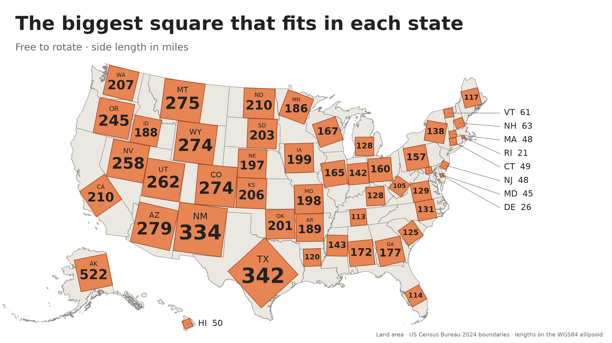
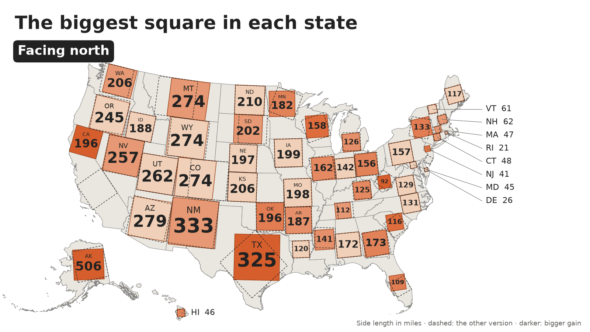
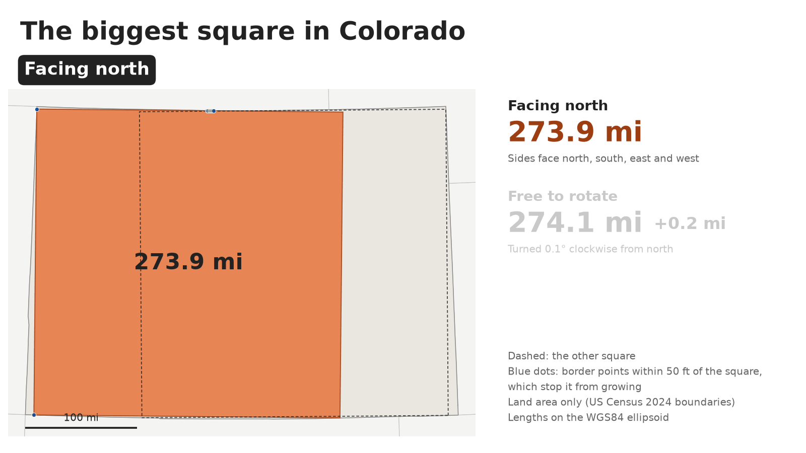
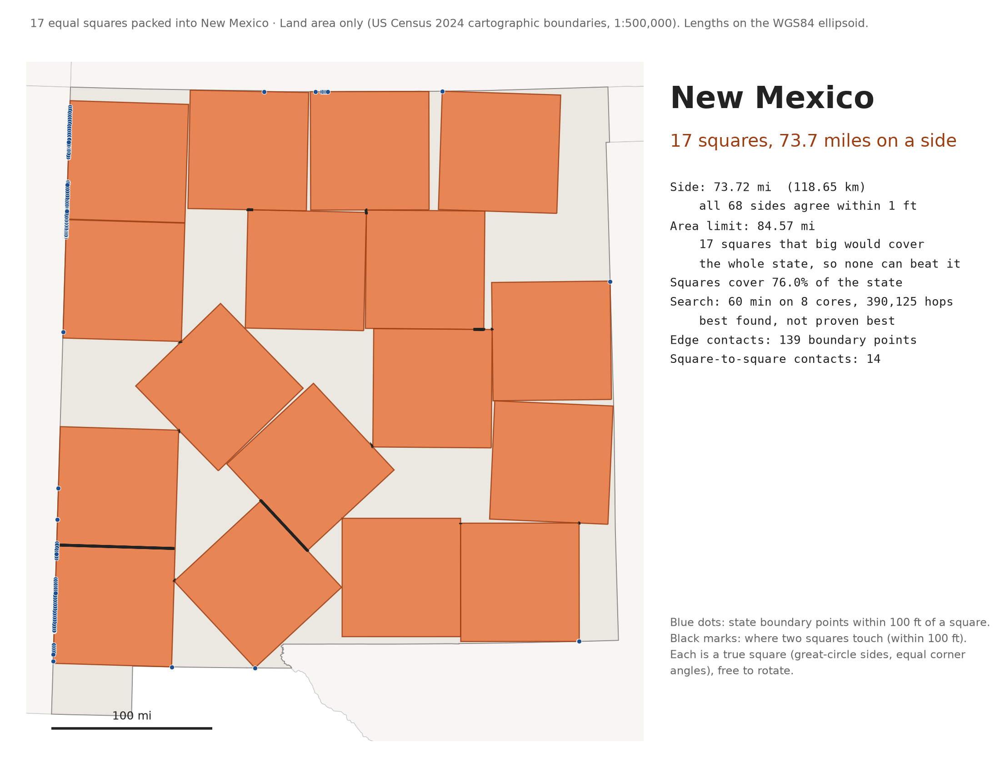
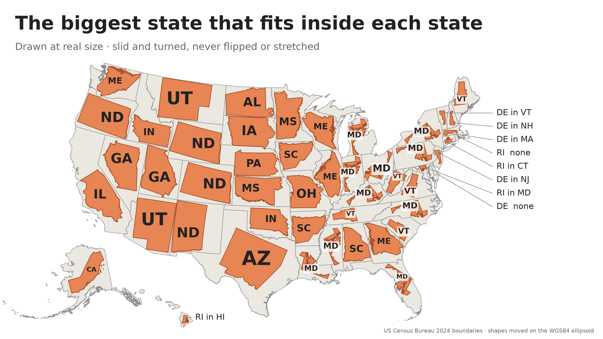
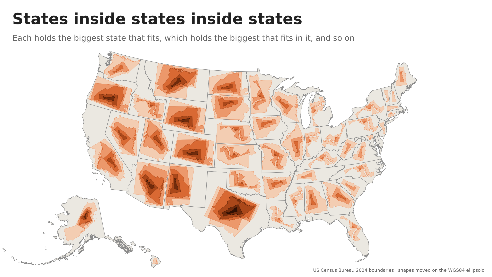
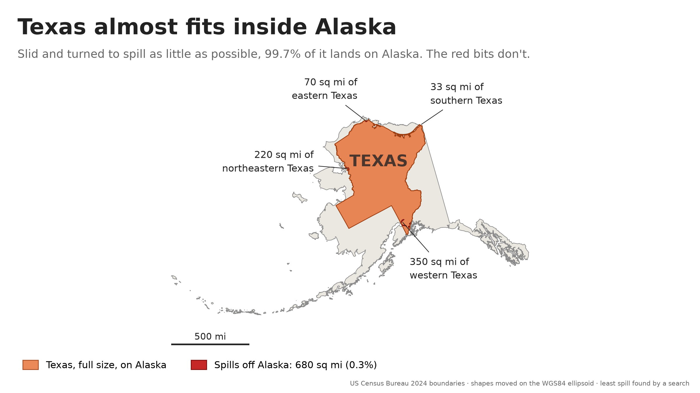
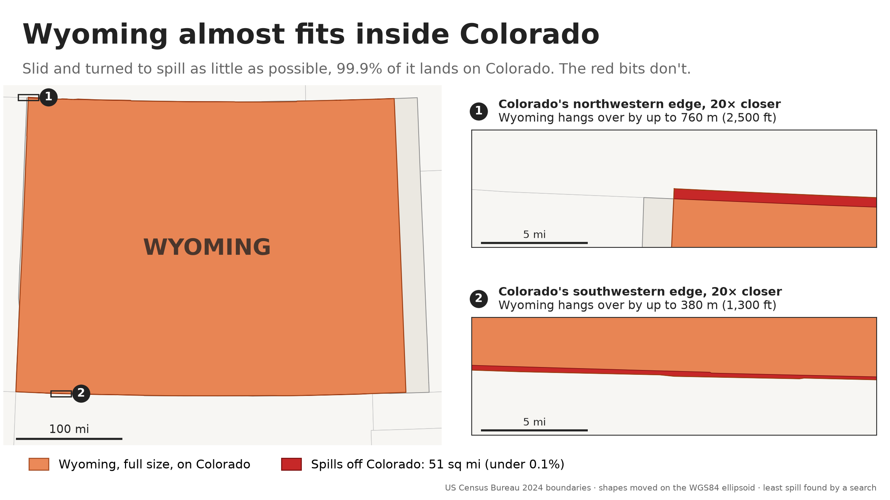
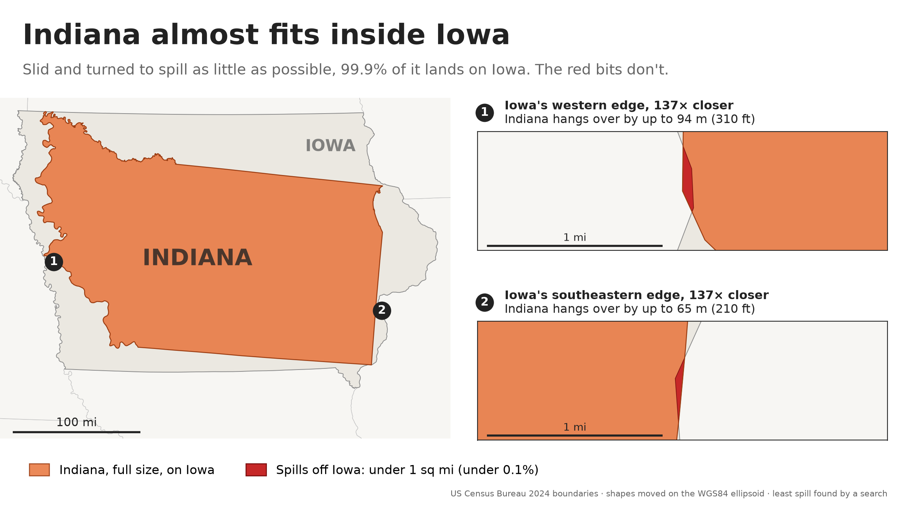
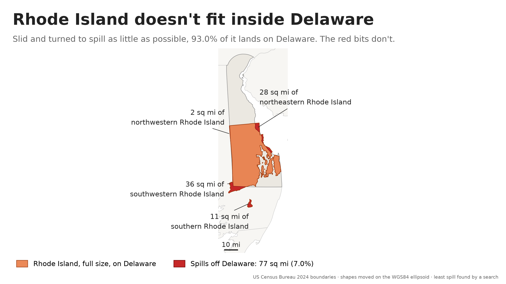

How big a square fits inside each US state? Which states fit inside which
other states? They sound like quick questions, but the Earth is curved and
slightly squashed, so every answer here is worked out on its real shape (the
WGS84 ellipsoid), using the Census Bureau's state boundaries. The code, the
method and every number are on
[GitHub](https://github.com/michael-gebis/state-squares).

Click any picture for the full-size version.

## The biggest square in each state

[](rotated_social.png)

Each square is a true square, as big as it can be while staying inside its
state, turned whichever way works best. Alaska's is 522 miles on a side;
Rhode Island's is 20.6. The search finds the best square, not just a good
one, to within a few tens of feet.

## Does turning help?

[](north_vs_rotated.gif)

Squares that must face north, then squares free to turn. Darker squares
gain more by turning: Texas's grows by 17 miles when it turns 43.6°.

[](CO_north_vs_rotated.gif)

Colorado's square gains only 0.2 miles by turning, but it moves 94 miles.
Colorado's borders run so close to east-west and north-south that a square
as tall as the state fits almost anywhere along it, and tiny wobbles in the
surveyed borders decide where the very best one goes.

## Seventeen squares

[](NM_17_squares.png)

Sixteen equal squares pack neatly into a bigger square. The best known way
to fit seventeen is a lopsided jumble that went viral in 2021 as "ugly
math". Here is the same puzzle for a state: an hour's search packed 17
squares, each 73.7 miles on a side, into New Mexico. That beats the 71.4
miles you'd get by shrinking the famous jumble to fit New Mexico's biggest
square.

## States inside states

[](nest_social.png)

Inside each state, the biggest other state that fits: slid and turned, but
never flipped or stretched, with every island landing on land.

- **Alaska** holds California, with room to spare.
- **Texas** holds Arizona. New Mexico misses by 0.4%.
- **California** holds Illinois, with room for a copy 10.7% bigger.
- **Maryland** is the answer for 10 states.
- **The closest call:** Indiana inside Iowa, at 99.96% of its size.
- **Delaware** holds nothing at all.

## All the way down

[](nest_chain_social.png)

The state inside each state has a state inside it, and so on, until the
chain reaches Delaware or Rhode Island. Texas goes deepest, six states down:
Arizona, Utah, Georgia, Maine, Vermont and Delaware.

## Texas almost fits inside Alaska

[](TX_in_AK_social.png)

Alaska is more than twice the size of Texas, yet Texas doesn't quite fit.
Turned to spill as little as possible, 99.7% of it lands on Alaska. The 680
square miles that don't are far West Texas, dipping into Cook Inlet; a
stretch of the Red River, in Kotzebue Sound; Sabine Pass, in the Arctic
Ocean; and the mouth of the Rio Grande.

## Why Wyoming doesn't fit inside Colorado

[](WY_in_CO_social.png)

Colorado is bigger and wider, but the two states are the same height:
about 276 miles from north to south. Wherever Wyoming's borders reach a
little farther apart than Colorado's, it hangs over, by up to 2,500 feet,
and turning it only makes it taller. Shrunk to 99.7% of its size, it fits.

If their borders ran exactly along lines of latitude, Wyoming would be
about 1,000 feet taller, because a degree of latitude is a little longer
the farther north you go.
But the surveyed borders wander north and south by up to about a mile,
which cancels most of that.

## The closest call: Indiana in Iowa

[](IN_in_IA_social.png)

Iowa is more than half again as big as Indiana, but Indiana is long: 324
miles from its southwestern tip to its northeastern corner, and Iowa is at
most 314 miles wide. So Indiana lies on a slant, corner to corner, and
touches Iowa's border in four places. Harrison County, Indiana, lands on
Harrison County, Iowa, and hangs over the Missouri into Nebraska by 310
feet. The Michigan line hangs over the Mississippi into Illinois by 210
feet. All told, about 15 acres spill. Shrunk to 99.95% of its size,
Indiana fits.

## Why Delaware holds nothing

[](RI_in_DE_social.png)

Delaware is nearly twice the size of Rhode Island, but it is only 35 miles
across at most, near its southern end, and Delaware Bay narrows it to 18
miles by Dover. Rhode Island is 38 miles across and 49 miles tall, with
Block Island 9 miles out to sea. Turned to spill as little as possible,
93.0% of it lands on Delaware. Most of Westerly hangs off Delaware's
southwestern corner into Maryland. Cumberland, Pawtucket and the East Bay towns land in
Delaware Bay. Block Island lands in Maryland, 15 miles south of Delaware.

## How it's done

- **Boundaries:** the Census Bureau's 2024 cartographic boundary files
  (1:500,000). A state's area includes its lakes and rivers.
- **Measurements:** every length and area is on the WGS84 ellipsoid.
- **Single squares:** a branch-and-bound search that finds the best square
  to within a few tens of feet.
- **Packing and fitting states:** searches, so their answers are the best
  found, not proven best. Moving a state from one place to another changes
  distances within it by less than 0.05%.

The [README](https://github.com/michael-gebis/state-squares#readme) has the
details, the caveats and every number.

## Make your own

You need [uv](https://docs.astral.sh/uv/). The first run downloads the
Census boundaries (about 3 MB).

```sh
git clone https://github.com/michael-gebis/state-squares.git
cd state-squares
uv run main.py spill TX AK      # full-size Texas on Alaska
uv run main.py nest CA          # the biggest state that fits in California
uv run main.py rotated WI CO    # the biggest squares in these states
```
